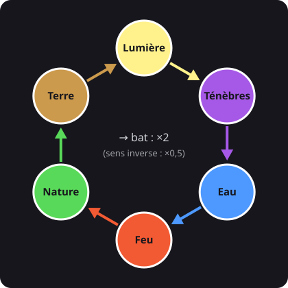

# Game design document

Document vivant et condensé. Une règle tranchée par Vespper passe dans `docs/decisions.md` ; ici on garde la description du jeu et les questions ouvertes. Les chiffres sont dans `data/` et le catalogue dans `docs/wiki/`.

## Vision

Un tower defense **classique**, lisible et profond, qui reprend le fonctionnement d'**Element TD** (mod Warcraft 3, puis Flash Element TD) et les habitudes des TD Warcraft 3 les plus connus : chemin connu à l'avance, tours de base et tours d'éléments, éléments à débloquer, vagues annoncées, intérêts sur l'or. Une partie dure 15 à 30 minutes.

Ce projet est aussi un banc d'essai : ce qui marche ici sera repris dans le roguelike `Gameproject`.

## Piliers

1. **Les éléments forcent des choix.** On ne peut pas tout débloquer : chaque essence est un pari sur les vagues à venir.
2. **Le placement compte.** Le chemin est fixe et connu : on cherche les coins et les doubles passages où une tour tire le plus longtemps.
3. **Lisible d'un coup d'œil.** Une couleur par élément, une forme par rôle (triangle = volant, croix = soigneur), chaque effet a un signe visible.
4. **Pas de hasard injuste.** La prochaine vague est annoncée (nombre, type, élément) : on perd parce qu'on a mal préparé.

## Boucle de jeu

1. Préparation : on voit la prochaine vague et un compte à rebours ; on commande des tours au bâtisseur, on améliore ou vend, on dépense ses essences.
2. La vague part toute seule à la fin du compte à rebours (30 s avant la première, puis 30 s après la fin des apparitions de la précédente ; si plus aucun ennemi n'est sur le terrain, le compte à rebours tombe à 3 s). On peut la lancer plus tôt : 0,5 or par seconde gagnée. Les vagues peuvent donc se chevaucher.
3. Chaque ennemi tué rapporte de l'or ; chaque ennemi qui sort coûte des vies.
4. Quand tous les ennemis d'une vague sont morts ou sortis : intérêts sur l'or gardé, bonus de fin de vague, parfois une essence.
5. Victoire après la dernière vague ; défaite à 0 vie.

## Cartes

- Grille de 24 × 15 cases, **chemin fixe** défini dans une `MapData` (`data/maps/`) par ses coins. Toutes les cases hors du chemin sont constructibles.
- Première carte : « Serpent », un chemin de 93 cases qui serpente quatre fois à travers la carte (comme Flash Element TD).
- On ajoutera d'autres cartes au fur et à mesure. Les **cartes libres** (labyrinthe construit avec les tours, façon Element TD original ou Wintermaul) viendront plus tard sous forme de mode.

## Bâtisseur

Un personnage, comme le builder des TD Warcraft 3, garde un pied vers le futur jeu à personnage :
- Il se déplace au clavier (ZQSD / WASD / flèches) et marche partout, chemin compris. Il ne peut pas être blessé.
- Cliquer une case **commande** une tour : l'or est payé tout de suite, un chantier apparaît, et le bâtisseur y marche puis la construit (1,5 s pour une tour de base, 2,5 s pour une tour d'élément). Les commandes s'enchaînent dans une file.
- Une tour en chantier ne tire pas. Annuler un chantier rembourse tout.
- **Améliorer** est aussi un chantier : l'or est payé, la tour est **hors service** jusqu'à ce que le bâtisseur vienne la finir (temps de construction × niveau visé). On améliore donc plutôt entre les vagues.
- Ce que ça apporte : poser loin coûte du temps, il faut anticiper avant la vague. À venir : objets ou talents qui accélèrent la construction.

## Éléments

Six éléments, en cycle comme dans Element TD :

> **Lumière > Ténèbres > Eau > Feu > Nature > Terre > Lumière**

La même roue est dans l'interface (panneau « Éléments ») : un clic sur un élément sombre dépense une essence pour le débloquer.

- Attaque forte (contre l'élément suivant) : dégâts × 2. Attaque faible (contre l'élément précédent) : × 0,5. Sinon × 1. Le Neutre n'a ni bonus ni malus.
- Chaque vague a un élément (la couleur des ennemis). Le poison suit aussi le multiplicateur.
- **Essences** : on en a 1 au départ, puis 1 de plus toutes les 4 vagues (5 sur une partie de 20 vagues pour 6 éléments). Une essence débloque un élément et sa tour.

## Armures (vagues neutres)

Les vagues sans élément ont une **armure**, en pierre-feuille-ciseaux avec les tours de base :

- **Flèche** ×1,5 contre **Léger**, ×0,5 contre Blindé.
- **Mortier** ×1,5 contre **Blindé**, ×0,5 contre Spectral.
- **Magie** ×1,5 contre **Spectral**, ×0,5 contre Léger.
- Les tours d'élément ignorent les armures. Signes : Léger = rond, Blindé = carré à plaques épaisses, Spectral = translucide avec un halo.

## Tours

- **Tours de base** (neutres, toujours disponibles) :
  - **Flèche** : pas chère, tir rapide sur une cible, touche les volants.
  - **Mortier** : obus lent à dégâts de zone, ne vise pas les volants.
  - **Magie** : éclair qui rebondit sur plusieurs ennemis, touche les volants.
- **Tours d'éléments** (une par élément, il faut l'avoir débloqué), avec les rôles d'Element TD :
  - **Lumière** : très longue portée. **Ténèbres** : énormes dégâts, tir lent. **Eau** : tir très rapide, petite zone, ralentit. **Feu** : tir très rapide, grande zone, courte portée. **Nature** : poison. **Terre** : grosse zone, ne vise pas les volants.
- **Amélioration** : 3 niveaux, dégâts × 1,6 par niveau. **Revente** : 75 % du total dépensé.

À venir :
- **Niveaux d'élément** : dépenser une essence de plus sur un élément déjà débloqué pour renforcer ses tours.
- **Tours doubles** (deux éléments, ex. Feu + Eau = Vapeur) puis **triples**, comme dans Element TD.
- **Tours de soutien** : ralentissement de zone, réduction d'armure, amplificateur de dégâts.

## Ennemis

Le rôle vient de l'**archétype**, l'élément vient de la **vague**.

| Archétype | Rôle |
|---|---|
| Fantassin | standard, référence d'équilibrage |
| Coureur | rapide et fragile |
| Horde | très nombreux et très fragiles : demande des dégâts de zone |
| Volant | ignoré par le Mortier et la Terre, la zone ne l'atteint pas |
| Soigneur | en mourant, rend 25 % de leurs PV aux ennemis proches : il faut tuer le groupe d'un coup |
| Colosse | lent et très résistant, coûte 2 vies |
| Seigneur (boss) | une seule unité énorme aux vagues 10 et 20, coûte 10 vies |
| Champion (élite) | glissé dans une vague neutre, il porte un **élément** (couronne dorée), coûte 2 vies : il faut la bonne tour d'élément |

À venir (Element TD) : **mécanique** (invulnérable 3 s toutes les 12 s), **mort-vivant** (revient une fois à 33 % de PV), **immunisé** aux ralentissements.

## Vagues

- 20 vagues dans `data/waves/` : archétype, élément **ou** armure, nombre, intervalle, multiplicateur de PV, élites éventuelles.
- Progression : vagues neutres à armure au début (on apprend Flèche / Mortier / Magie), élites à élément à partir de la vague 5, vagues entièrement élémentaires surtout en fin de partie (12, 14, 15, 17 à 20). Volants aux vagues 4, 9, 14, 18.
- La prochaine vague est annoncée dans la barre du haut.
- Lancement automatique avec compte à rebours ; Espace (ou le bouton) lance la suivante en avance contre de l'or.

## Économie

- Départ : 80 or, 20 vies, 1 essence.
- Or par ennemi tué (selon l'archétype), puis en fin de vague : **intérêts de 3 %** sur l'or gardé + bonus de 10 + 2 × numéro de la vague.
- Les intérêts récompensent l'épargne : construire tôt ou garder de l'or est un vrai choix.

## Contrôles

Clavier + souris. Voir le tableau du `README.md`.

## Direction artistique (prototype)

Formes simples dessinées en code, fond sombre, chemin en terre, éléments de jeu saturés. Couleurs : Lumière jaune pâle, Ténèbres violet, Eau bleu, Feu rouge-orangé, Nature vert, Terre ocre, Neutre gris clair.

## Questions ouvertes

- Combien de vagues pour une partie complète (Element TD en a 60) ?
- Niveaux d'élément et tours doubles : avec les mêmes essences, ou une seconde monnaie ?

## Pistes à l'étude (proposées le 2026-11-25)

- **Arbres d'amélioration** : au niveau 2 puis 3, chaque tour choisit entre deux branches (ex. Flèche : « Perforante » qui traverse / « Rapide »). Oblige à choisir, se combine bien avec les tours d'éléments.
- **Tours mixtes** (doubles, puis triples) : deux éléments débloqués ouvrent une tour combinée, comme dans Element TD. C'est la vraie profondeur du genre ; à faire après les arbres.
- **Partie « idle » de l'économie** : plutôt une couche légère (bâtiments d'économie qui rapportent de l'or au fil du temps, recherche des tours mixtes qui avance pendant les vagues) qu'un vrai jeu idle hors ligne, pour ne pas casser la tension des vagues.
