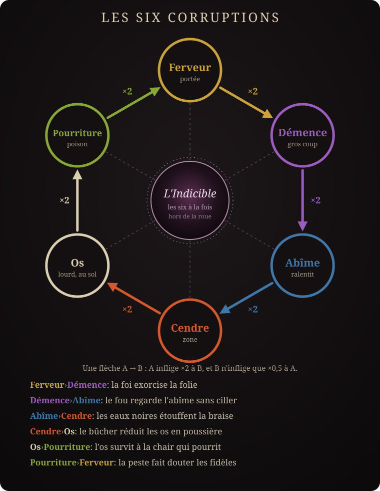
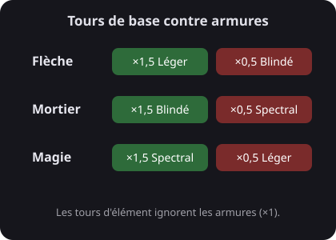

# Game design document

Document vivant et condensé. Une règle tranchée par Vespper passe dans `docs/decisions.md` ; ici on garde la description du jeu et les questions ouvertes. Les chiffres sont dans `data/` et le catalogue dans `docs/wiki/`.

## Vision

Un tower defense **classique**, lisible et profond, qui reprend le fonctionnement d'**Element TD** (mod Warcraft 3, puis Flash Element TD) et les habitudes des TD Warcraft 3 les plus connus : chemin connu à l'avance, tours de base et tours de corruption, corruptions à débloquer, vagues annoncées, intérêts sur l'or. Une partie dure 15 à 30 minutes.

Ce projet est aussi un banc d'essai : ce qui marche ici sera repris dans le roguelike `Gameproject`.

## Piliers

1. **Les corruptions forcent des choix.** On ne peut pas tout débloquer : chaque stigmate est un pari sur les vagues à venir.
2. **Le placement compte.** Le chemin est fixe et connu : on cherche les coins et les doubles passages où une tour tire le plus longtemps.
3. **Lisible d'un coup d'œil.** Une couleur par corruption, une forme par rôle (triangle = volant, croix = soigneur), chaque effet a un signe visible.
4. **Pas de hasard injuste.** La prochaine vague est annoncée (nombre, type, corruption) : on perd parce qu'on a mal préparé.

## Boucle de jeu

1. Préparation : on voit la prochaine vague et un compte à rebours ; on commande des tours au bâtisseur, on améliore ou vend, on dépense ses stigmates.
2. La vague part toute seule à la fin du compte à rebours (30 s avant la première, puis 30 s après la fin des apparitions de la précédente ; si plus aucun ennemi n'est sur le terrain, le compte à rebours tombe à 3 s). On peut la lancer plus tôt : 0,5 or par seconde gagnée. Les vagues peuvent donc se chevaucher.
3. Chaque ennemi tué rapporte de l'or ; chaque ennemi qui sort coûte des vies.
4. Quand tous les ennemis d'une vague sont morts ou sortis : intérêts sur l'or gardé, bonus de fin de vague, parfois un stigmate.
5. Victoire après la dernière vague ; défaite à 0 vie.

## Cartes

- Grille de 24 × 15 cases, **chemin fixe** défini dans une `MapData` (`data/maps/`) par ses coins. Les cases hors du chemin sont constructibles, sauf les ruines.
- Première carte : « Serpent », un chemin de 93 cases qui serpente quatre fois à travers la carte (comme Flash Element TD).
- **Terres corrompues** : quelques cases portent une corruption. Une tour de cette corruption y fait +25 % de dégâts, une tour de la corruption opposée −25 %. La roue compte aussi pour le placement. Plus tard, le **biome** de la carte décidera quelles corruptions dominent.
- **Ruines** : des obstacles bloquent les meilleures cases. Un clic paie 20 or et le bâtisseur va les démolir (4 s). Chaque ruine pose une question : démolir tôt pour une bonne case, ou garder l'or ?
- On ajoutera d'autres cartes au fur et à mesure. Les **cartes libres** (labyrinthe construit avec les tours, façon Element TD original ou Wintermaul) viendront plus tard sous forme de mode.

## Bâtisseur

Un personnage, comme le builder des TD Warcraft 3, garde un pied vers le futur jeu à personnage :
- Il se déplace au clavier (ZQSD / WASD / flèches) et marche partout, chemin compris. Il ne peut pas être blessé.
- Cliquer une case **commande** une tour : l'or est payé tout de suite, un chantier apparaît, et le bâtisseur y marche puis la construit (1,5 s pour une tour de base, 2,5 s pour une tour de corruption). Les commandes s'enchaînent dans une file.
- Une tour en chantier ne tire pas. Annuler un chantier rembourse tout.
- Il **démolit les ruines** commandées, dans la même file que les tours.
- **Améliorer** est aussi un chantier : l'or est payé, la tour est **hors service** jusqu'à ce que le bâtisseur vienne la finir (temps de construction × niveau visé). On améliore donc plutôt entre les vagues.
- Ce que ça apporte : poser loin coûte du temps, il faut anticiper avant la vague. À venir : objets ou talents qui accélèrent la construction.

## Corruptions

Six **corruptions** (à la place des éléments d'Element TD, pour un ton grimdark), en cycle :

> **Ferveur > Démence > Abîme > Cendre > Os > Pourriture > Ferveur**

La même roue est dans l'interface (panneau « Corruptions ») : un clic sur une corruption sombre dépense un stigmate pour la débloquer.

Chaque flèche se raconte : la foi exorcise la folie, le fou regarde l'abîme sans ciller, les eaux noires étouffent la braise, le bûcher réduit les os en poussière, l'os survit à la chair qui pourrit, la peste fait douter les fidèles. **L'Indicible**, hors de la roue, est la corruption ultime : les six à la fois.

- Attaque forte (contre la corruption suivante) : dégâts × 2. Attaque faible (contre la corruption précédente) : × 0,5. Sinon × 1. Le Neutre n'a ni bonus ni malus.
- Chaque vague a une corruption (la couleur des ennemis). Le poison suit aussi le multiplicateur.
- **Stigmates** : on en a 1 au départ, puis 1 de plus toutes les 4 vagues (5 sur une partie de 20 vagues pour 6 corruptions). Un stigmate débloque une corruption et sa tour.

## Armures (vagues neutres)

Les vagues sans corruption ont une **armure**, en pierre-feuille-ciseaux avec les tours de base :

- **Arbalète** ×1,5 contre **Chair**, ×0,5 contre Carapace.
- **Trébuchet** ×1,5 contre **Carapace**, ×0,5 contre Spectre.
- **Encensoir** ×1,5 contre **Spectre**, ×0,5 contre Chair.
- Les tours de corruption ignorent les armures. Signes : Chair = rond, Carapace = carré à plaques épaisses, Spectre = translucide avec un halo.

## Tours

- **Tours de base** (neutres, toujours disponibles) :
  - **Arbalète** : pas chère, tir rapide sur une cible, touche les volants.
  - **Trébuchet** : pierre lente à dégâts de zone, ne vise pas les volants.
  - **Encensoir** : fumée sacrée qui rebondit sur plusieurs ennemis, touche les volants.
- **Tours de corruption** (une par corruption, il faut l'avoir débloquée), avec les rôles d'Element TD :
  - **Ferveur** (cierges, reliques) : très longue portée. **Démence** : énormes dégâts, tir lent. **Abîme** : tir très rapide, petite zone, ralentit. **Cendre** : tir très rapide, grande zone, courte portée. **Pourriture** : poison. **Os** : grosse zone, ne vise pas les volants.
- **Amélioration** : 3 niveaux, en **arbre** : au passage au niveau 2, on choisit l'une des deux branches de la tour (U ou I), puis le niveau 3 renforce la même branche. Chaque branche a son profil (dégâts, cadence, portée, zone, rebonds, ralentissement, poison) ; le choix est définitif. **Revente** : 75 % du total dépensé.

À venir :
- **Niveaux de corruption** : dépenser un stigmate de plus sur une corruption déjà débloquée pour renforcer ses tours.
- **Tours doubles** (deux corruptions, ex. Abîme + Cendre = Soufrière) puis **triples**, comme dans Element TD.
- **Tours de soutien** : ralentissement de zone, réduction d'armure, amplificateur de dégâts.

## Ennemis

Le rôle vient de l'**archétype**, la corruption vient de la **vague**.

| Archétype | Rôle |
|---|---|
| Fantassin | standard, référence d'équilibrage |
| Coureur | rapide et fragile |
| Horde | très nombreux et très fragiles : demande des dégâts de zone |
| Volant | ignoré par le Trébuchet et l'Os, la zone ne l'atteint pas |
| Soigneur | en mourant, rend 25 % de leurs PV aux ennemis proches : il faut tuer le groupe d'un coup |
| Colosse | lent et très résistant, coûte 2 vies |
| Seigneur (boss) | une seule unité énorme aux vagues 10 et 20, coûte 10 vies |
| Champion (élite) | glissé dans une vague neutre, il porte un **corruption** (couronne dorée), coûte 2 vies : il faut la bonne tour de corruption |

À venir (Element TD) : **mécanique** (invulnérable 3 s toutes les 12 s), **mort-vivant** (revient une fois à 33 % de PV), **immunisé** aux ralentissements.

## Vagues

- 20 vagues dans `data/waves/` : archétype, corruption **ou** armure, nombre, intervalle, multiplicateur de PV, élites éventuelles.
- Progression : vagues neutres à armure au début (on apprend Arbalète / Trébuchet / Encensoir), élites à corruption à partir de la vague 5, vagues entièrement corrompues surtout en fin de partie (12, 14, 15, 17 à 20). Volants aux vagues 4, 9, 14, 18.
- La prochaine vague est annoncée dans la barre du haut.
- Lancement automatique avec compte à rebours ; Espace (ou le bouton) lance la suivante en avance contre de l'or.

## Économie

- Départ : 80 or, 20 vies, 1 stigmate.
- Or par ennemi tué (selon l'archétype), puis en fin de vague : **intérêts de 3 %** sur l'or gardé + bonus de 10 + 2 × numéro de la vague.
- Les intérêts récompensent l'épargne : construire tôt ou garder de l'or est un vrai choix.

## Contrôles

Clavier + souris. Voir le tableau du `README.md`.

## Direction artistique (prototype)

Formes simples dessinées en code, fond sombre, chemin en terre. Ton grimdark (inspiration Vermis). Couleurs : Ferveur or terni, Démence violet maladif, Abîme bleu-noir, Cendre braise, Os ivoire sale, Pourriture vert bile, Neutre gris.

## Questions ouvertes

- Combien de vagues pour une partie complète (Element TD en a 60) ?
- Niveaux de corruption et tours doubles : avec les mêmes stigmates, ou une seconde monnaie ?

## Pistes à l'étude

### Fusions de corruptions (2026-11-26)

Noms et idées d'effet des 15 fusions de deux corruptions, à débloquer d'une partie à l'autre par des défis (côté roguelike) :

| Corruptions | Tour | Idée |
|---|---|---|
| Ferveur + Démence | Flagellant | cadence qui monte sur la même cible |
| Ferveur + Abîme | Baptistère noir | longue portée, ralentit fort |
| Ferveur + Cendre | Inquisiteur (hérétique) | la cible brûle puis explose à sa mort |
| Ferveur + Os | Reliquaire | aura de dégâts pour les tours voisines |
| Ferveur + Pourriture | Martyr gâté | poison qui se transmet à la mort |
| Démence + Abîme | Puits murmurant | gros coup, fait parfois reculer |
| Démence + Cendre | Pyromane | tirs de zone au hasard, très forts |
| Démence + Os | Danse macabre (hérétique) | les morts se relèvent un instant et gênent |
| Démence + Pourriture | Ver de l'esprit | poison qui ralentit de plus en plus |
| Abîme + Cendre | Soufrière | nuage brûlant persistant qui ralentit |
| Abîme + Os | Ossuaire englouti | coup très lourd au sol, ralentit longtemps |
| Abîme + Pourriture | Tourbière (hérétique) | marais persistant : poison et ralentissement |
| Cendre + Os | Charnier ardent | grosse zone au sol qui laisse des braises |
| Cendre + Pourriture | Mal des Ardents | poison de feu qui se propage |
| Os + Pourriture | Goule | achève les ennemis presque morts |

**Opposés** (Ferveur ↔ Cendre, Démence ↔ Os, Abîme ↔ Pourriture), retenus par Vespper :
- **Schisme** : deux tours opposées côte à côte perdent chacune 25 % de dégâts.
- **Fusions hérétiques** : les trois fusions d'opposés sont plus fortes mais ont un prix (ex. 1 vie par vague) et sont plus dures à débloquer.
- Plus tard, en mod de difficulté ou malus conditionnel : **Rejet**, un ennemi touché par l'opposé de sa corruption gagne un bouclier court.

À trouver : la place des trois tours de base dans la roue.

Côté roguelike (plus tard) : avant une run, on connaît le **biome**, qui donne la probabilité de chaque type d'ennemi.

### Carte et chemin (2026-11-26)

Ce qui existe dans les TD et qu'on garde pour plus tard (terres corrompues et ruines sont faites) :
- **Portes qui s'ouvrent** (Kingdom Rush) : une deuxième entrée se réveille vers la vague 8, puis une troisième ; chaque vague annonce par où elle arrive. Demande une carte pensée pour.
- **Aiguillages** (Dungeon Warfare) : un levier que le bâtisseur actionne pour envoyer les ennemis sur un détour plus long. Premier pas vers le mode labyrinthe.
- **Chemin qui grandit** (Rogue Tower) : toutes les quelques vagues, le chemin s'allonge ou une entrée apparaît, tiré au hasard. Plutôt pour le côté roguelike.
- **Hauteurs** (Rogue Tower) : cases qui donnent de la portée.
- **Événements de carte** : marée d'Abîme qui ralentit un tronçon, nuit qui réduit la portée, pluie de cendres…
- **Biomes** : avant une run, on connaît le biome, qui donne les corruptions dominantes (terres) et la probabilité de chaque type d'ennemi.

### Autres pistes (2026-11-25)

- **Partie « idle » de l'économie** : plutôt une couche légère (bâtiments d'économie qui rapportent de l'or au fil du temps, recherche des tours mixtes qui avance pendant les vagues) qu'un vrai jeu idle hors ligne, pour ne pas casser la tension des vagues.
