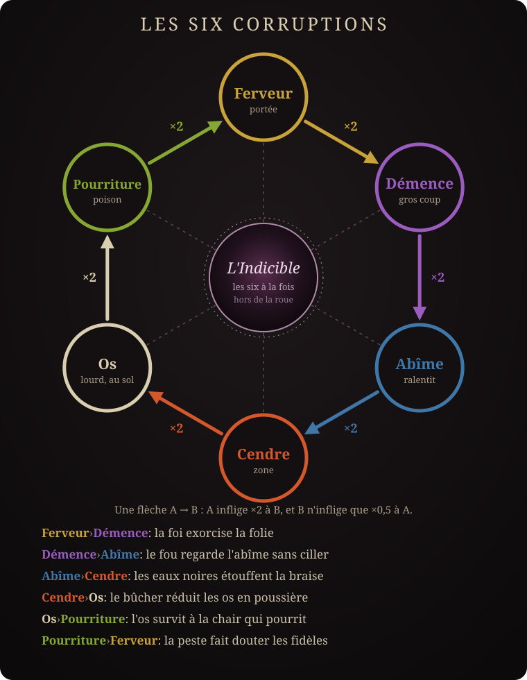

# Corruptions

Cycle : **Ferveur > Démence > Abîme > Cendre > Os > Pourriture > Ferveur**. Une attaque fait × 2 à la corruption qu'elle bat et × 0,5 à celle qui la bat (`data/rules.tres`). Le Neutre (tours de base) n'a ni bonus ni malus, en attaque comme en défense. Les opposés de la roue (Ferveur ↔ Cendre, Démence ↔ Os, Abîme ↔ Pourriture) se font × 1 pour l'instant.

Dans le code, une corruption est un `Element.Type` (`scripts/data/element.gd`) et un stigmate est une « essence » (`Main.essences`).

| Corruption | Code | Couleur | Fort contre | Faible contre | Tour | Pourquoi elle bat la suivante |
|---|---|---|---|---|---|---|
| Ferveur | `FERVOR` | or terni | Démence | Pourriture | très longue portée | la foi exorcise la folie |
| Démence | `MADNESS` | violet maladif | Abîme | Ferveur | énormes dégâts, tir lent | le fou regarde l'abîme sans ciller |
| Abîme | `ABYSS` | bleu-noir | Cendre | Démence | tir très rapide, petite zone, ralentit | les eaux noires étouffent la braise |
| Cendre | `ASH` | braise | Os | Abîme | tir très rapide, grande zone, courte portée | le bûcher réduit les os en poussière |
| Os | `BONE` | ivoire sale | Pourriture | Cendre | grosse zone, pas les volants | l'os survit à la chair qui pourrit |
| Pourriture | `ROT` | vert bile | Ferveur | Os | poison | la peste fait douter les fidèles |

« Faible contre X » veut dire : les attaques de cette corruption font × 0,5 aux ennemis X.

**Stigmates** : 1 au départ, +1 à la fin des vagues 4, 8, 12, 16 et 20. Un stigmate débloque une corruption (clic sur la roue du panneau « Corruptions »).

**L'Indicible** (à venir) : la corruption ultime, hors de la roue, les six à la fois.
